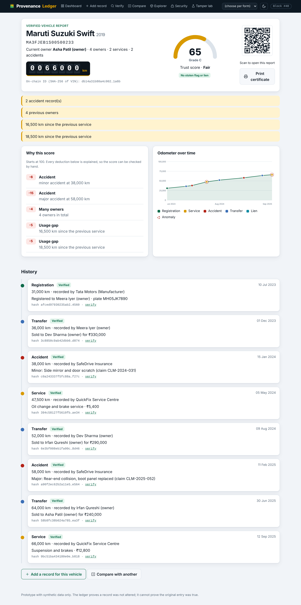
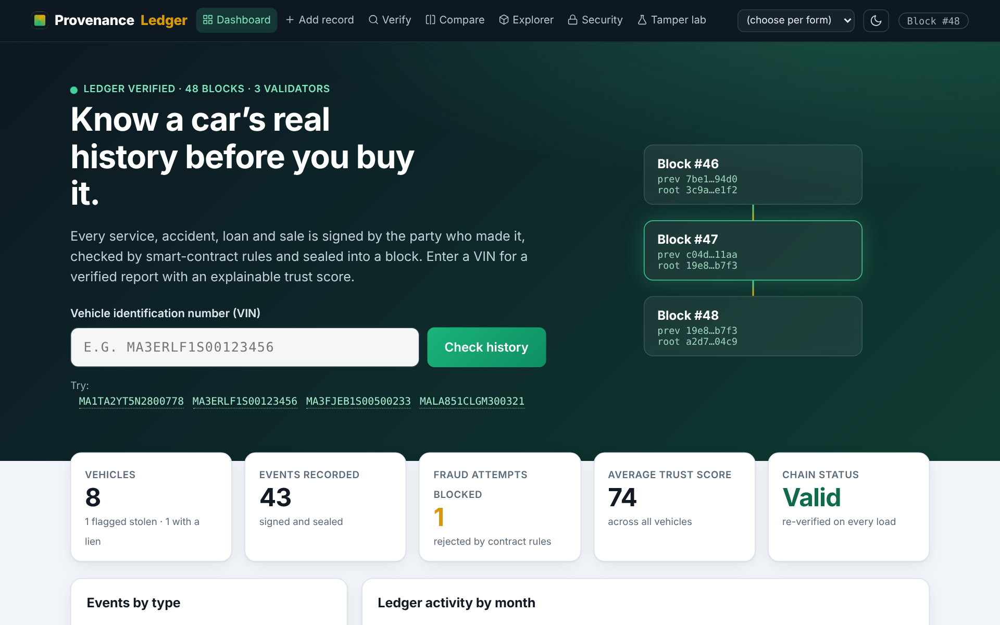
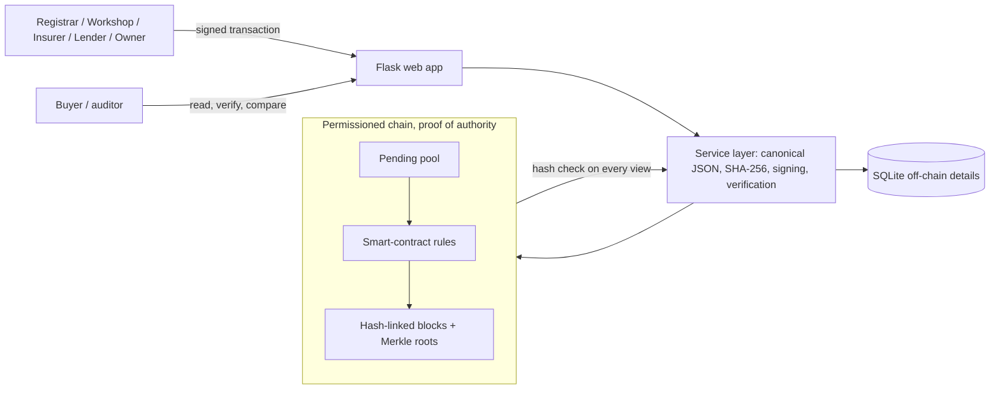

# Vehicle Lifecycle, Service History and Used-Car Provenance Ledger

A blockchain project that gives used-car buyers an **independently verifiable vehicle history**. Registration, service, accident, ownership, stolen-status and loan-lien events are signed by accountable roles, checked by smart-contract rules, and sealed into hash-linked blocks. Buyers get a verified report with an **explainable trust score**, anomaly detection, a **QR code**, document verification and a **tamper lab**.

| Buyer report | Dashboard |
|---|---|
|  |  |

## Features

| Area | What it does |
|---|---|
| **Smart-contract rules** | Roles (Registrar, Service centre, Insurer, Lender); odometer can never decrease; only the owner can sell; no sale while stolen or under lien; one lien at a time; duplicate VINs rejected |
| **Ledger** | Ed25519-signed transactions, nonces (replay protection), Merkle roots, hash-linked blocks, 3-validator proof of authority, full chain validation |
| **Privacy** | Names, prices and documents stay off-chain (SQLite); only SHA-256 hashes and minimal facts are on-chain |
| **Trust score A-E** | Starts at 100; every deduction listed with its reason (stolen, accidents, lien, owners, service gaps, implausible usage, tampering) |
| **Odometer chart** | Readings over time with anomalies ringed |
| **QR code + print certificate** | Scannable link to the live report (own QR encoder, verified with a decoder) |
| **Verify page** | Paste a hash/JSON or upload a file: is it anchored on the ledger, and who signed it? |
| **Compare** | Two vehicles side by side |
| **Security centre** | Live integrity checks, log of every blocked fraud attempt, validator schedule, role registry |
| **Tamper lab** | Five attacks run on a copy of the chain; all are detected |
| **Dashboard** | KPIs and charts (server-side SVG, works offline), dark mode, responsive layout |

## Quick start

```bash
python -m venv .venv && source .venv/bin/activate     # Windows: .venv\Scripts\activate
pip install -r requirements.txt
python scripts/seed_demo.py --reset     # 8 vehicles, dated history, 9 blocked fraud attempts
python run.py                           # open http://127.0.0.1:5000
```

Try VIN `MA3FJEB1S00500233` (4 owners, 2 accidents, service gaps: Grade C), `MALA851CLGM300321` (stolen, Grade E) or `MAT6240A1NP400112` (clean, Grade A). Use **Add record** with the wrong role or a lower odometer to see the contract reject it, then look at **Security** and **Tamper lab**.

```bash
python -m unittest discover -s tests -v   # 40 tests
python scripts/tamper_demo.py             # command-line tamper demo
python scripts/benchmark.py               # reproduces the performance results
```

## Solidity contract (Remix / Hardhat)

`contracts/VehicleLedger.sol` implements the same rules for Ethereum-compatible networks (roles incl. Lender, lien functions, custom errors, events).

* **Remix:** paste the file into remix.ethereum.org, compile with 0.8.20+, deploy on Remix VM, call `grantRole(address, 1..4)` (1 Registrar, 2 ServiceCenter, 3 Insurer, 4 Lender).
* **Hardhat:** `npm install && npx hardhat test` (10 tests), `npx hardhat node`, `npm run deploy:local`.

## Architecture



## Documents (Stage 1)

| File | Content |
|---|---|
| `docs/Stage1_Project_Report.docx` / `.pdf` | 65-page report in the Stage 1 structure (literature survey, existing approaches, concepts, proposed approach, architecture, comparative analysis, findings, references) |
| `docs/Stage1_Presentation.pptx` | 25 slides with speaker notes |
| `docs/benchmark_results.json` | Measured results |
| `docs/VIVA_QA.md` | Viva preparation |
| `docs/screenshots/` | Screenshots and diagrams |

## Structure

```
contracts/VehicleLedger.sol      Solidity contract (roles, rules, liens)
test/, scripts/deploy.js         Hardhat tests and deployment
app/ledger/                      Crypto, contract rules, chain, proof of authority
app/service.py                   Wallets, off-chain DB, reports, rejection log, tamper simulator
app/analytics.py, app/charts.py  Trust score, anomalies, SVG charts
app/qr.py                        QR encoder
app/main.py, templates, static   Flask routes and UI
scripts/                         seed_demo, tamper_demo, benchmark
tests/                           40 unit and integration tests
```

## Honest limitations

* The web app runs its **own** permissioned chain; it does not yet call the Solidity contract (web3 bridge is future work). Solidity tests are provided but were written without a compiler in the authoring environment: run `npx hardhat test` yourself.
* Three simulated validators in one process; no network. Saving the whole chain to one JSON file is O(n) per write (see the benchmark); use an append-only store for scale.
* A ledger proves a record **was not altered** and who signed it; it cannot prove the original entry was **true**. Authenticated odometer feeds (OBD-II) are future work.
* Demo keys are stored in `data/wallets.json` (git-ignored). Trust-score weights are design choices, not calibrated.

## References

See Chapter 12 of the report (34 references: NIST IR 8202, Ethereum, Hyperledger Fabric, Brousmiche et al. 2018, Abbade et al. 2020, Chanson et al. 2017, Butera et al. 2023, and others).

## Licence

MIT
